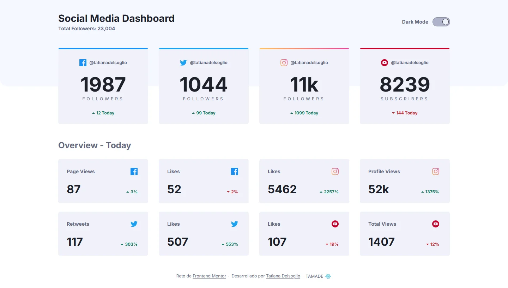
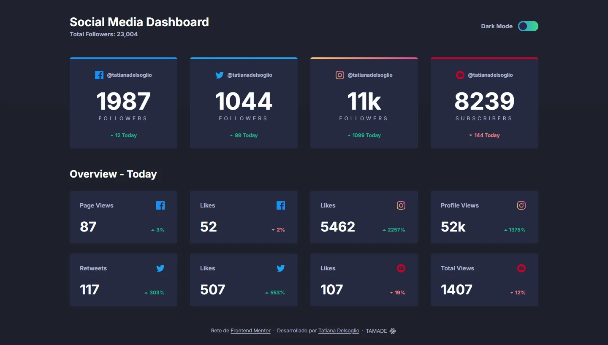
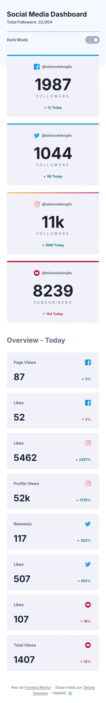
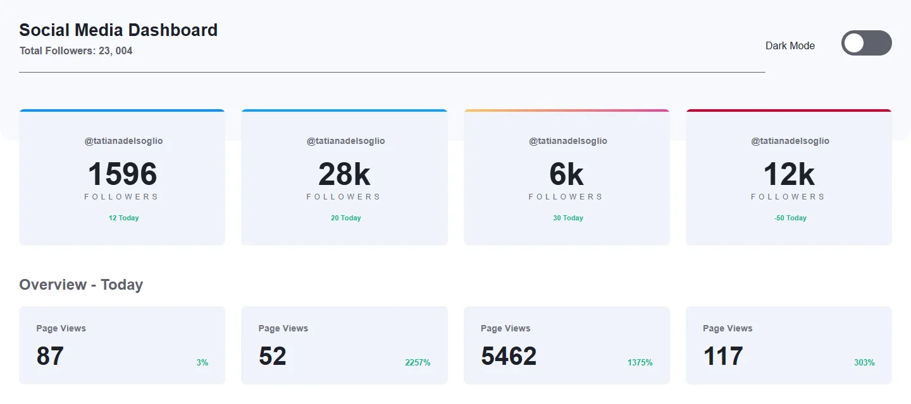

<a id="top"></a>

**[Español](#español) | [English](#english)**

# Social Media Dashboard

[](https://github.com/tatianadelsoglio/SocialMediaDashboard/actions/workflows/ci.yml)


---

## Español

Dashboard de redes sociales con tema claro y oscuro, fiel al diseño y accesible (WCAG 2.1 AA).

> **Reto de Frontend Mentor.** El diseño, los íconos y los textos son de [Frontend Mentor](https://www.frontendmentor.io): [Social media dashboard with theme switcher](https://www.frontendmentor.io/challenges/social-media-dashboard-with-theme-switcher-6oY8ozp_H). El código es mío.

**Demo:** https://tatianadelsoglio.github.io/SocialMediaDashboard/

### Capturas







### Qué hace

Muestra los seguidores de cuatro redes y la actividad del día, con un interruptor de tema. Los datos son los del diseño, con el usuario `@tatianadelsoglio`.

### Qué se trabajó

**Fidelidad al diseño**
- Tipografía, espaciados, radios, grillas y estados hover medidos contra los JPG del reto a 375 y 1440 px: las cajas de texto y tarjetas coinciden con un margen de ±1 px.
- Todos los colores del style guide son tokens de Tailwind con su valor HSL exacto (`src/index.css`).
- Borde superior de color por red (degradado en Instagram) y flechas de subida y bajada que toman el color según el signo.

**Tema**
- Por defecto sigue `prefers-color-scheme`, también si el sistema cambia con la página abierta.
- La elección del interruptor se guarda en `localStorage` y pisa al sistema. Si `localStorage` no está disponible, la elección vale para la sesión.
- Sin parpadeo al cargar: un script inline en `index.html` aplica el tema antes del primer pintado.
- Sincronizado entre pestañas con el evento `storage`.
- `theme-color` acompaña al tema activo, incluida la elección manual.

**Accesibilidad**
- Interruptor: checkbox nativo con `role="switch"`, operable con Tab y Espacio, con el nombre accesible "Dark Mode" tomado del texto visible y foco visible.
- Semántica: un `h1`, secciones con encabezado y las tarjetas como listas.
- Lectores de pantalla: cada tarjeta se lee completa (por ejemplo, "Facebook, @tatianadelsoglio, 1987 Followers, 12 more Today"); las flechas son decorativas y el sentido va en texto oculto.
- Movimiento reducido: la transición entre temas se desactiva con `prefers-reduced-motion`.

### Contraste

Varios colores del style guide no llegaban a AA (4,5:1 para texto de este tamaño). Se ajustaron **al mínimo necesario**: mismo tono y saturación, solo cambia la luminosidad, y se mide también sobre el fondo de hover. Los valores originales siguen definidos en `src/index.css`, al lado de los ajustados.

| Token | Valor del guide | Valor AA | Antes (tarjeta / hover) | Después (tarjeta / hover) |
|---|---|---|---|---|
| `--color-lime-green-aa` (verde, tema claro) | `hsl(163, 72%, 41%)` | `hsl(163, 72%, 27.2%)` | 2,37 / 2,05 | 4,92 / 4,50 |
| `--color-bright-red-aa-light` | `hsl(356, 69%, 56%)` | `hsl(356, 69%, 46.9%)` | 3,83 / 3,33 | 4,92 / 4,50 |
| `--color-bright-red-aa-dark` | `hsl(356, 69%, 56%)` | `hsl(356, 69%, 70.9%)` | 3,30 / 2,60 | 5,37 / 4,52 |
| `--color-card-hover-light`* | `hsl(232, 33%, 91%)` | `hsl(232, 33%, 92.6%)` | Gray 650: 4,28 | 4,51 |
| `--color-card-hover-dark`* | `hsl(228, 26%, 27%)` | `hsl(228, 26%, 25%)` | Green 500: 4,22 | 4,50 |

\* Fondos de hover medidos en los JPG del reto (no figuran en el style guide).

Componentes no textuales (mínimo 3:1), resueltos con un anillo sutil sin cambiar los colores del guide:

| Elemento (tema claro) | Antes | Después |
|---|---|---|
| Pista del interruptor contra la franja superior | 1,94 | 3,13 |
| Perilla contra la pista | 1,86 | 5,93 |

Contrastes medidos en Chrome sobre los colores pintados. **Varios valores quedan justo en 4,5:1** (entre 4,50 y 4,52): son el mínimo que pasa, sin margen.

### Stack y por qué

- **React 19**: componentes chicos y tipados para tarjetas, interruptor y pie.
- **Vite 8**: servidor de desarrollo y build rápidos, con la base configurada para GitHub Pages.
- **TypeScript 6 (strict)**: contratos claros para los datos de las tarjetas y el tema.
- **Tailwind CSS 4**: los colores del style guide como tokens en `@theme`, sin CSS suelto.
- **Inter (Fontsource)**: la fuente del diseño servida desde el proyecto, solo con el subset latin.
- **Vitest + Testing Library + jsdom**: tests del tema, el interruptor, las tarjetas y el pie desde el punto de vista de quien usa la página.
- **ESLint**: reglas de React Hooks y TypeScript.
- **GitHub Actions + GitHub Pages**: lint, typecheck, tests y build en cada push y PR a `main`; deploy automático cuando el CI pasa en `main`.

### Antes y después

La primera versión es de 2021 y está en el tag [`v1-2021`](https://github.com/tatianadelsoglio/SocialMediaDashboard/tree/v1-2021).

| | 2021 | Hoy |
|---|---|---|
| Base | Create React App 4, React 17, JavaScript | Vite 8, React 19, TypeScript strict |
| Estilos | Un archivo CSS por componente, fuente del sistema | Tailwind 4 con los tokens del style guide, Inter |
| Íconos | Referenciados en `images/`, carpeta que no estaba en el repo: no se veía ninguno, ni los de las redes ni las flechas | Incluidos y decorativos |
| Datos | Números distintos al diseño; 4 tarjetas en el overview, todas "Page Views"; el valor negativo se mostraba en verde ("-50 Today") | Los datos y las 8 tarjetas del diseño; flecha y color según el signo |
| Tema | Seguía al sistema, sin guardar la elección | Sistema, elección guardada, sin parpadeo, sincronizado entre pestañas |
| Accesibilidad | Checkbox oculto con `display: none`, no operable con teclado | Interruptor accesible, semántica y contraste AA |
| Tests y CI | No | Vitest y GitHub Actions |



*La versión 2021 (tag `v1-2021`) levantada hoy con su propio build.*

### Cómo correrlo

Requiere **Node ≥ 22.18** (está en `.nvmrc`).

```bash
npm install
npm run dev
```

| Script | Qué hace |
|---|---|
| `npm run dev` | Servidor de desarrollo |
| `npm run build` | Typecheck y build de producción en `dist/` |
| `npm run preview` | Sirve el build localmente |
| `npm run lint` | ESLint |
| `npm run typecheck` | TypeScript sin emitir archivos |
| `npm test` | Tests una vez |
| `npm run test:watch` | Tests en modo watch |

### Créditos

- Diseño: [Frontend Mentor](https://www.frontendmentor.io).
- Desarrollo: Tatiana Delsoglio · [GitHub](https://github.com/tatianadelsoglio) · [LinkedIn](https://www.linkedin.com/in/tatiana-delsoglio/)

[↑ Volver arriba](#top)

---

## English

Social media dashboard with light and dark themes, faithful to the design and accessible (WCAG 2.1 AA).

> **Frontend Mentor challenge.** The design, icons and copy belong to [Frontend Mentor](https://www.frontendmentor.io): [Social media dashboard with theme switcher](https://www.frontendmentor.io/challenges/social-media-dashboard-with-theme-switcher-6oY8ozp_H). The code is mine.

**Live demo:** https://tatianadelsoglio.github.io/SocialMediaDashboard/

### Screenshots


### What it does

Shows followers for four networks and today's activity, with a theme toggle. The data comes from the design, with the username `@tatianadelsoglio`.

### What I worked on

**Design fidelity**
- Typography, spacing, radii, grids and hover states measured against the challenge JPGs at 375 and 1440 px: text and card boxes match within ±1 px.
- Every color in the style guide is a Tailwind token with its exact HSL value (`src/index.css`).
- Colored top border per network (gradient for Instagram) and up/down arrows colored by sign.

**Theme**
- Follows `prefers-color-scheme` by default, including when the system changes while the page is open.
- The toggle choice is saved to `localStorage` and overrides the system. If `localStorage` is unavailable, the choice lasts for the session.
- No flash on load: an inline script in `index.html` applies the theme before the first paint.
- Synced across tabs through the `storage` event.
- `theme-color` follows the active theme, including the manual choice.

**Accessibility**
- Toggle: a native checkbox with `role="switch"`, operable with Tab and Space, with the accessible name "Dark Mode" taken from the visible text, and a visible focus ring.
- Semantics: one `h1`, sections with headings and the cards as lists.
- Screen readers: each card reads as a whole (for example, "Facebook, @tatianadelsoglio, 1987 Followers, 12 more Today"); arrows are decorative and the direction is in hidden text.
- Reduced motion: the theme transition is turned off with `prefers-reduced-motion`.

### Contrast

Several style guide colors didn't reach AA (4.5:1 for text this size). They were adjusted **by the minimum needed**: same hue and saturation, only lightness changes, and the hover background is checked too. The original values are still defined in `src/index.css`, next to the adjusted ones.

| Token | Style guide value | AA value | Before (card / hover) | After (card / hover) |
|---|---|---|---|---|
| `--color-lime-green-aa` (green, light theme) | `hsl(163, 72%, 41%)` | `hsl(163, 72%, 27.2%)` | 2.37 / 2.05 | 4.92 / 4.50 |
| `--color-bright-red-aa-light` | `hsl(356, 69%, 56%)` | `hsl(356, 69%, 46.9%)` | 3.83 / 3.33 | 4.92 / 4.50 |
| `--color-bright-red-aa-dark` | `hsl(356, 69%, 56%)` | `hsl(356, 69%, 70.9%)` | 3.30 / 2.60 | 5.37 / 4.52 |
| `--color-card-hover-light`* | `hsl(232, 33%, 91%)` | `hsl(232, 33%, 92.6%)` | Gray 650: 4.28 | 4.51 |
| `--color-card-hover-dark`* | `hsl(228, 26%, 27%)` | `hsl(228, 26%, 25%)` | Green 500: 4.22 | 4.50 |

\* Hover backgrounds measured from the challenge JPGs (not in the style guide).

Non-text components (3:1 minimum), solved with a subtle ring without changing the style guide colors:

| Element (light theme) | Before | After |
|---|---|---|
| Toggle track against the top band | 1.94 | 3.13 |
| Knob against the track | 1.86 | 5.93 |

Contrast measured in Chrome on the rendered colors. **Several values sit right at 4.5:1** (between 4.50 and 4.52): they are the minimum that passes, with no margin.

### Stack and why

- **React 19**: small, typed components for cards, toggle and footer.
- **Vite 8**: fast dev server and build, with the base set for GitHub Pages.
- **TypeScript 6 (strict)**: clear contracts for card data and theme.
- **Tailwind CSS 4**: style guide colors as tokens in `@theme`, no loose CSS.
- **Inter (Fontsource)**: the design's font served from the project, latin subset only.
- **Vitest + Testing Library + jsdom**: tests for theme, toggle, cards and footer from the user's point of view.
- **ESLint**: React Hooks and TypeScript rules.
- **GitHub Actions + GitHub Pages**: lint, typecheck, tests and build on every push and PR to `main`; automatic deploy when CI passes on `main`.

### Before and after

The first version is from 2021 and lives in the [`v1-2021`](https://github.com/tatianadelsoglio/SocialMediaDashboard/tree/v1-2021) tag.

| | 2021 | Today |
|---|---|---|
| Base | Create React App 4, React 17, JavaScript | Vite 8, React 19, strict TypeScript |
| Styles | One CSS file per component, system font | Tailwind 4 with the style guide tokens, Inter |
| Icons | Referenced from `images/`, a folder missing from the repo: none showed, neither the network icons nor the arrows | Included and decorative |
| Data | Numbers different from the design; 4 overview cards, all "Page Views"; the negative value showed in green ("-50 Today") | The design's data and all 8 cards; arrow and color by sign |
| Theme | Followed the system, choice not saved | System, saved choice, no flash, synced across tabs |
| Accessibility | Checkbox hidden with `display: none`, not keyboard operable | Accessible toggle, semantics and AA contrast |
| Tests and CI | No | Vitest and GitHub Actions |


*The 2021 version (`v1-2021` tag) running today from its own build.*

### Running it

Requires **Node ≥ 22.18** (pinned in `.nvmrc`).

```bash
npm install
npm run dev
```

| Script | What it does |
|---|---|
| `npm run dev` | Dev server |
| `npm run build` | Typecheck and production build in `dist/` |
| `npm run preview` | Serves the build locally |
| `npm run lint` | ESLint |
| `npm run typecheck` | TypeScript without emitting files |
| `npm test` | Run tests once |
| `npm run test:watch` | Tests in watch mode |

### Credits

- Design: [Frontend Mentor](https://www.frontendmentor.io).
- Development: Tatiana Delsoglio · [GitHub](https://github.com/tatianadelsoglio) · [LinkedIn](https://www.linkedin.com/in/tatiana-delsoglio/)

[↑ Back to top](#top)
